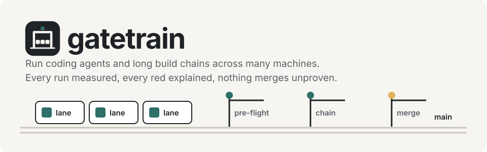
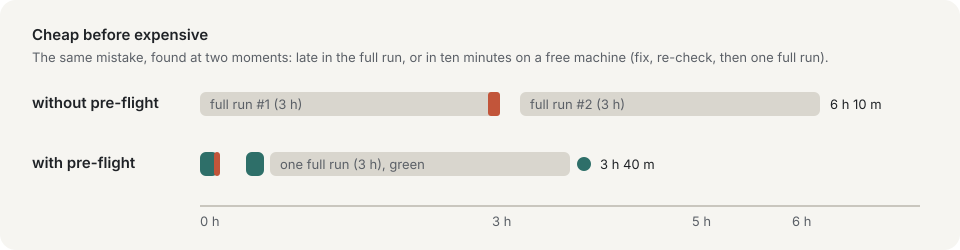
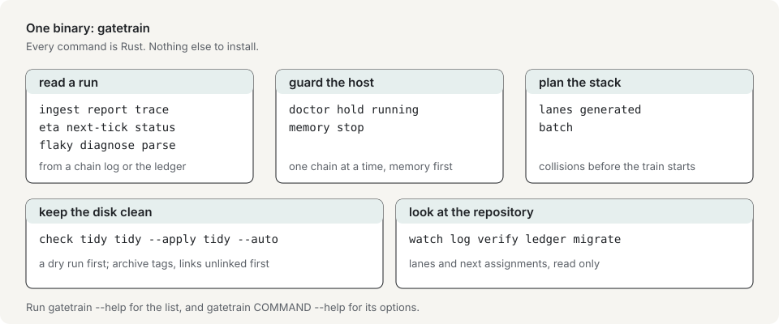
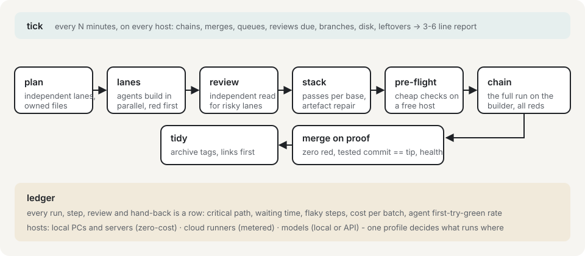
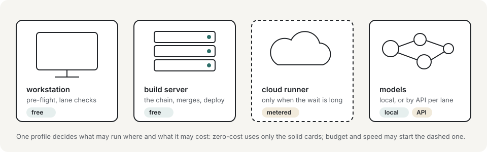

<p align="center">
  
</p>

<p align="center">
  <b>Run coding agents and long build chains across many machines.</b><br>
  Local PCs, home servers, cloud runners &mdash; every run measured, every red explained, nothing merges unproven.
</p>

<p align="center">
  <a href="#installation">Install</a> &middot;
  <a href="#how-it-works">How it works</a> &middot;
  <a href="#the-basic-workflow">Workflow</a> &middot;
  <a href="#profiles-from-zero-cost-to-cloud">Profiles</a> &middot;
  <a href="docs/lessons.md">Lessons</a> &middot;
  <a href="#roadmap">Roadmap</a>
</p>

<p align="center"><sub>Status: early. The method runs every day on a large monorepo. The tool is one Rust binary; the skills, plugin and docs are usable today.</sub></p>

---

## Why gatetrain

Once several agents write code in parallel and one verification run takes hours, the hard part is no longer writing code. It is keeping the
line moving without lying to yourself.

| what goes wrong | what gatetrain does |
|---|---|
| A three-hour run dies on a mistake a ten-minute check would have caught. | **Pre-flight** every batch on a free machine first; the expensive run starts only when it is green. |
| Combining many branches quietly duplicates a line, drops a list entry, or re-applies old commits. | **Stack** by base, repair only known artefacts, and leave everything else red for a person. |
| An agent says "tests pass". | **Every claim carries its counts**, red first: a test that never failed has not proven anything. |
| Risky changes (money, permissions, data, network) slip through with the rest. | An **independent review** that gets the diff, not your conclusion, before the change is stacked. |
| Machines sit idle while work queues; the bill or the disk surprises you. | One **ledger** of every run and step: waiting time, idle hosts, flaky steps, cost per batch, agent quality. |
| A red is read as a real defect (or waved through as a flake) and the whole run is repeated. | **Diagnose** classifies every red from its own output: load flake, port collision, uncommitted generated file, shrink-only list drift, Windows-only artefact; anything unknown stays `real`. |
| Cleanup deletes real work. | **Tidy** that cannot: archive tags first, links unlinked first, exact names only, never the main checkout. |

<p align="center"></p>

## Installation

gatetrain is one Rust binary, plus skills written as plain Markdown. There is no server and no database service to run: the ledger is one SQLite file that is compiled in. There is one small Python exception on Windows hosts, below.

### The binary

You need Rust 1.89 or newer. Release binaries are not published yet, so build it from source:

```bash
git clone https://github.com/MassRelayAI/gatetrain
cd gatetrain
cargo install --path crates/gatetrain-cli      # puts `gatetrain` in ~/.cargo/bin
gatetrain --version
```

To skip the install, run `cargo build --release` and use `target/release/gatetrain`.

One limit to know about: on a Windows host, `doctor` and `tidy` still call `python` for two small probes (the real path of a folder, and free disk space). Everything else is Rust. Linux and macOS hosts need nothing.

### Claude Code (plugin)

```bash
/plugin marketplace add MassRelayAI/gatetrain
/plugin install gatetrain@gatetrain
```

### Any other agent (Codex, Cursor, Gemini CLI, OpenCode, ...)

Copy the skills where your agent reads instructions, and point its rules file at `skills/using-gatetrain/SKILL.md`:

```bash
cp -r skills ./.agents/gatetrain-skills     # or your agent's skills or rules folder
```

### Your machines and the ledger

```bash
cp config/hosts.example.toml config/hosts.toml    # git-ignored: your machines, roles, disks, cost, profile
gatetrain ledger migrate --db gatetrain.db        # creates the ledger file, or brings an old one forward
```

`ingest` and `status` also create and migrate the ledger when it is missing.

### The commands

<p align="center"></p>

This is the list as `gatetrain --help` prints it. Each command has its own `--help` with every option.

```text
Commands:
  parse      Parse a chain log (docs/log-format.md) and print what was read
  diagnose   Classify every red step of a chain log: class, evidence, remedy, rerun needed
  report     Text report of a chain log or of a run in the ledger
  trace      Chrome trace events of a chain log, as one JSON line
  eta        Predict when a running chain ends, from the ledger's history
  config     The hosts.toml file
  log        The decision log
  batch      The batch state machine (design 3)
  ledger     The ledger file
  check      Find leftovers: build targets, worktrees, containers, images, cache, recycle bin (read-only)
  tidy       Clean the leftovers `check` finds (dry run unless --apply or --auto)
  watch      Read a repository's lanes and say what to do next (read-only): live, merged awaiting tidy, stale, ready to stack, blocked, next assignments
  ingest     Parse a chain log into the ledger (a run id already there is refused; --replace only for a running or stopped run)
  status     One table for every chain log given: state, eta and when to look next
  next-tick  When to look at a running chain next
  flaky      Steps red in one finished run and green in another on the same commit
  stop       Stop a chain: queued followers first, then the processes (Linux only; a dry run unless --yes)
  doctor     Pre-run checks per host
  lanes      Pre-stack collision radar over lane refs
  generated  List untracked files under the generated directories
  hold       Hold the host lock as the PARENT of a command (the chain); `--status` reads the lock instead
  memory     Memory in the host model: record a step peak, or ask the admission rule
  running    Is a chain running? Reads the host lock, never the process table (exit 0 when held)
```

The three that change your disk have one shape. `check` only reads. `tidy` is a dry run until you ask:

```text
$ gatetrain tidy --help
Clean the leftovers `check` finds (dry run unless --apply or --auto)

Options:
      --config <CONFIG>  [default: hosts.toml]
      --host <HOST>      
      --apply            execute the plan (the default is a dry run)
      --class <CLS>      comma list of: targets,worktrees,containers,images,cache,trash
      --auto             for schedulers: check, then apply only the unattended classes
```

### Try it on your own chain log

Your chain prints a few marker lines, see [`docs/log-format.md`](docs/log-format.md).

```bash
gatetrain ingest my-chain.log --db gatetrain.db            # parse it into the ledger
gatetrain report --db gatetrain.db --run my-chain          # totals, reds, slowest steps, busiest stretch
gatetrain diagnose my-chain.log                            # per red step: class, evidence, remedy, full rerun needed
gatetrain trace my-chain.log > trace.json                  # open trace.json in https://ui.perfetto.dev
gatetrain eta my-running.log --db gatetrain.db             # when will it end (needs earlier runs in the ledger)
gatetrain next-tick --log my-running.log --db gatetrain.db # when to look next
```

The sample logs in `tests/fixtures/` have real timings and shape with generic names: a 466-step run with one red, then a run in progress. This is the output of the Rust binary on them:

```text
$ gatetrain ingest tests/fixtures/run-one-red.log --db gatetrain.db
ingested run-one-red: red, 466 steps, 1 red
$ gatetrain report --db gatetrain.db --run run-one-red
run run-one-red: red  commit 0a1b2c3d4  host builder-1
steps 466  finished 466  red 1  cached 0  unknown start 0
wall time 2h47m29s  busy time 16h55m15s  average parallelism 6.1
reds: e2e-001(rc=1)
10 slowest steps:
     39m33s  test-api
     32m47s  test-tools
     28m14s  cargo-test
...
$ gatetrain eta tests/fixtures/run-partial-red.log --db gatetrain.db
eta 2026-11-11T20:33:32.497407+07:00
band p25-p75: 2026-11-11T20:04:02.756155+07:00 .. 2026-11-11T21:14:40.820733+07:00
basis: 250 steps finished at 2.1/min, parallelism 5.3 (max seen 8), 215 steps remaining, last log line 2026-11-11T19:18:15+07:00
dominant remaining steps: db-gate-264 (~9m31s), db-gate-318 (~6m02s), db-gate-404 (~5m46s), db-gate-425 (~5m43s), db-gate-273 (~5m37s)
$ gatetrain next-tick --log tests/fixtures/run-partial-red.log --db gatetrain.db --now 2026-11-11T18:15:00+07:00
5 min - a red appeared in the last 5 minutes: look again at the minimum
```

A one-table view of several runs at once:

```text
$ gatetrain status --log tests/fixtures/run-one-red.log --log tests/fixtures/run-partial-red.log --log tests/fixtures/run-stopped.log --now 2026-11-11T18:15:00+07:00
run              host       steps    reds  state    eta    band         next look (min)
run-one-red      builder-1  466/466  1     red      -      -            -
run-partial-red  builder-1  250/465  6     running  20:33  20:04-21:14  5
run-stopped      builder-1  31/465   1     stopped  -      -            -
next look: 5 min (run-partial-red: a red appeared in the last 5 minutes: look again at the minimum)
```

Pre-run checks. Real output of `doctor` on a Windows workstation with a small local config (`reach = "local"`; the removable disk is not mounted, the tool does not exist and one port is listed twice, all on purpose):

```text
$ gatetrain doctor --config local.toml
PASS  L18,L30  this-pc disk: F:/: 417 GB free >= 20
WARN  L18      this-pc disk: E:/external-ssd: removable disk is not mounted  -> fix: attach and mount E:/external-ssd; what it enables is dropped meanwhile
PASS  L18,L19  this-pc capacity: can run now: preflight
PASS  L31      this-pc containers: no exited container with prefix gate-
PASS  L29      this-pc toolchain: git: git version 2.45.1.windows.1
PASS  L29      this-pc toolchain: cargo: cargo 1.98.1 (797e8a9bc 2026-08-05)
FAIL  L29      this-pc toolchain: no-such-tool: does not resolve or prints no version  -> fix: install no-such-tool or fix the PATH or version file the chain uses
PASS  L21      this-pc ports: port 5500 is outside every ephemeral or reserved range
PASS  L21      this-pc ports: port 5501 is outside every ephemeral or reserved range
PASS  L21      this-pc ports: port 5500 is outside every ephemeral or reserved range
FAIL  L22      this-pc ports: duplicate port(s): 5500  -> fix: give every gate its own port
```

`gatetrain stop PATTERN [--follower PATTERN] [--yes]` is a dry run until `--yes`, and works on Linux only. The ssh runner and the Linux checks are covered by tests with canned outputs, not yet by a run against a real host.

Before stacking, `gatetrain lanes` reads only git and tells you which lanes will collide, with each other, with a commit they both carry, and with main itself. Real output from a throwaway repo (`auth` and `billing` branched from an unmerged side branch that edits `server.rs`; `ui` from main edits the same import line as the side branch; main has since moved on and edited the line `ui` also edits in `app.js`):

```text
$ gatetrain lanes --repo . --main main auth billing ui
lanes against main

1. bases and containment
   auth: merge-base c267d76fa, 2 own commits, base for stacking a322f8843
   billing: merge-base c267d76fa, 2 own commits, base for stacking a322f8843
   ui: merge-base c267d76fa, 1 own commits
   both carry 1 commits up to a322f8843 (auth and billing): stack with that tip as lane base
   pass 1: base c267d76fa (on main): ui
   pass 1: stack the carried commits up to a322f8843 (base c267d76fa) on main, once, for auth and billing
   pass 2: base a322f8843 (carried tip, after pass 1): auth, billing

2. collision hotspots
   SAME-LINES  app.js  [ui x main] lines 1-2 -> certain conflict, merge by hand
   SAME-LINES  server.rs  [auth x billing] lines 3 -> certain conflict, merge by hand
   SAME-LINES  server.rs  [carried a322f8843 x ui] lines 1 -> certain conflict, merge by hand
   CODE-BOTH   server.rs: lanes auth, ui, billing -> a person reads both diffs

3. doubled-line risk
   server.rs:3 [auth x billing] -> likely doubled line after stacking: keep one, check it appears once
   server.rs:1 [carried a322f8843 x ui] -> likely doubled line after stacking: keep one, check it appears once

4. resource clashes
   none

5. paired counts (heuristic)
   ui: EXPECTED 13 -> 12 in app.js; count changed here but its check still says 13 in gate.test.mjs:1 -> update it
   ui: EXPECTED 13 -> 12 in gate.mjs; count changed here but its check still says 13 in gate.test.mjs:1 -> update it

6. parallel plan
   group 1: auth
   group 2: billing  (after the groups above; conflicts with them)
   group 3: ui  (after the groups above; conflicts with them)
3 lanes: 3 independent groups; 3 certain conflicts; 0 shared hubs; 0 resource clashes
```

It is advice (exit 0 unless git fails); the same data with `--json`. Heuristics are listed in [`modules/plan.md`](modules/plan.md).

### Tests

```bash
cargo test --workspace
cargo clippy --workspace --all-targets -- -D warnings
python tools/privacy_check.py        # the one Python script left: a repository gate, not the product
```

Real run on Windows, from `cargo test --workspace`: 361 tests, 0 failed (gatetrain-core 290, gatetrain-cli 70, the test child program 1). Clippy with `-D warnings` is clean. The privacy gate has 7 tests of its own (`python -m unittest discover -s tests -p test_privacy.py`). CI repeats all of it on Linux, macOS and Windows. The tests that once compared against the Python version now read what it printed: `tests/golden/` and `tests/corpus/`.

Works alongside single-branch development skill sets (brainstorming, plans, test-driven development, code review, such as
[Superpowers](https://github.com/obra/superpowers)): those make one lane good; gatetrain runs many lanes on many machines and proves the batch.

## How it works

<p align="center"></p>

Work is cut into **lanes**. A lane is one branch, one worktree, one owner and a list of owned files. Lanes whose files do not overlap run **in parallel** on whatever machine has a free slot.

Finished lanes are **stacked** into a **batch**. The batch gets a cheap **pre-flight**. Then one **chain** (the full verification run) proves it on the builder. Only a chain that is green on exactly the tested commit **merges**.

A cheap recurring **tick** watches every machine, chain, lane and disk. It acts only where a written rule covers it, and it reports in a few lines. Everything is a row in the **ledger**. Every failure that happened twice becomes a **lesson**: a rule plus a test that proves it.

The binary is the part that measures and guards:

| step of the flow | commands that do it |
|---|---|
| plan and stack | `lanes`, `generated`, `batch` |
| pre-flight and chain | `doctor`, `hold`, `memory`, `running`, `stop` |
| read the run | `ingest`, `report`, `trace`, `eta`, `next-tick`, `status`, `diagnose`, `flaky` |
| tick | `status`, `next-tick`, `watch` |
| tidy | `check`, `tidy` |
| the record | `ledger`, `log` |

The agents' side of each step is a skill, see [the basic workflow](#the-basic-workflow).

### What a tick looks like (example)

```text
tick 14:53  batch-42 run 2: 255/440 steps, 0 red, merger armed
            preflight-1: lane gates idle; builder-1 SSD 176 GB free; 0 leftover containers
            lane auth-door READY (review: 2 should-fix, fixed; 8/8 gates as the app role)
            next: stack batch-43 when 42 merges (3 lanes, 1 base)
            waits on you: nothing
```

## The basic workflow

1. **using-gatetrain** - Activates when a session runs more than one lane, more than one machine, or a long verification run. Introduces the rest.
2. **plan-lanes** - Activates before work is split. Maps the code first, cuts lanes with owned files, finds hidden coupling, marks risky lanes, schedules the longest first across free machines.
3. **review-lane** - Activates when a lane is handed to a worker and when a risky lane is finished. A brief with red-first proof; an independent reviewer who gets the diff, not your conclusion.
4. **preflight-and-chain** - Activates when lanes are finished. Stacks by base, repairs known artefacts only, pre-flights on a free machine, runs the full chain on the builder, stops safely.
5. **tick** - Activates on a timer. Chains, merges, queues, reviews due, branches, disk; acts only on written rules; reports in a few lines.
6. **tidy** - Activates after a merge. Archive tags first, links unlinked first, exact names only, never the main checkout.

**Mandatory, not suggestions:** claims carry counts, tests fail before they pass, nothing merges unless the tested commit is the merged one.

## Tidy and check

Disks fill with leftovers: build folders of merged lanes, a shared chain target that outgrew its budget, exited throwaway containers,
unused test images, a recycle bin nobody empties. The tool finds and cleans them itself.

```
gatetrain check [--config hosts.toml] [--host NAME] [--json]     # read-only; exit 1 when a threshold is crossed
gatetrain tidy  [--host NAME] [--class targets,worktrees,containers,images,cache,trash]   # dry run
gatetrain tidy  --apply [--class ...]                             # execute, class by class
gatetrain tidy  --auto                                            # for a scheduler: check, then the unattended classes only
```

`check` prints one table per host (disk free against its minimum, build targets with size, idle time, lane, merged, CACHEDIR.TAG,
worktrees with branch, merged, dirty and links inside, exited containers, images, build cache, recycle bin, browser profiles in the
wrong place) and a "would tidy" plan with bytes per item. Exit code 1 means a threshold is crossed: a disk below its minimum, a target over
its budget, a profile inside an evidence folder.

### What tidy may remove, and why

Tidy removes an item only when one of these rules names it. The rule is written to the action log with the removal. An item that matches no rule is never removed and is reported as `kept: no rule`.

| class | rule (as logged) | what must be true |
|---|---|---|
| worktrees | `merged-clean-worktree` | The branch is not main, and its content is on main: an ancestor, or a merge into main changes nothing (`git merge-tree --write-tree`, git 2.38+). No uncommitted work (ignored files do not count). Not locked, not a link, not on a keep list, a plain branch name, and no file changed in the last `worktree_min_idle_days` when that is set. |
| targets | `lane-merged-target` | A folder under `target_roots`, named after a lane whose branch content is on main. Idle for `min_idle_min`, no file inside changed in that time, not named by a running `hold`, its worktree not dirty, not a link, not on a keep list. |
| targets | `orphan-target` | The same, for a lane with no branch, and only when `orphan_targets = "clean"`. |
| targets | `over-budget-target` | A folder named in `targets` whose measured size is over its `budget_gb`. Attended only: `--auto` never takes it. |
| containers | `exited-container` | The name starts with `container_prefix`, and the container exited and is not running. Removed by exact name. |
| images | `unused-image` | The name matches `image_patterns`, and no container uses it. Removed by exact name. |
| cache | `old-build-cache` | `cache_days` is above 0. Prunes build cache older than that. |
| trash | `old-trash-entry` | A direct child of `trash_dir`, older than `trash_days`. Age counts from when tidy first saw it, or from the stamp in its name, whichever is later. |

Every `--apply` and `--auto` action appends one line to the tidy log (`log`, default `tidy-log.jsonl`): the item, the class, the bytes before and after, the time, the `rule` and the `why` (the facts for this item, such as `branch line/x is on main`). A line with status `intent` is written before the action, so a crash leaves a trace.

### Protected paths

`protect` is a list of paths or globs. The default is empty.

```toml
[tidy]
protect = ["/srv/captures", "/srv/repo/docs/reference/*"]
```

In a dry run, `--apply` and `--auto`, no class removes an item that is inside a protected path, is a protected path, or contains one. A link that leads into a protected path counts too, and is never followed for deletion. The item is kept and printed as `kept: protected`. The check runs twice: when the plan is made, and again at the moment of each action.

It ends in bounded time and is never silent (L76): each worktree, target and recycle-bin entry is reported on stderr as soon as it is
judged (`tidy: worktree 3/54 <path>: not merged`; ` [12s]` when an item was slow; `GATETRAIN_PROGRESS=0` turns it off). The cheap checks
decide first (keep lists, merge proof, `git status`): only a worktree that would be removed has its links listed, its size measured
and its idle time walked, and only a recycle-bin entry old enough to go is sized (a kept worktree shows `-` for links). All probes of
one item share `item_budget_s`; an item that runs out is `skipped`, its size unknown, and it is never planned.

Sizes are best effort (L51). A size probe that times out or fails gives an unknown size, printed as `?`, never a fake 0: a
recycle-bin entry is still removed by age; a target with a budget and an unknown size is reported as `size unknown` and is never
cleaned on budget grounds; totals read "X + N item(s) of unknown size"; when `cargo clean` cannot be measured by size, the tool compares the
disk's free space before and after, and says `freed: unknown` if even that is unavailable. On a slow disk set `measure = "age-only"`
in its `[[hosts.disks]]` entry: paths under it are never sized, only aged and checked with `df`.

```toml
[[hosts.disks]]
path = "/srv/trash-disk"
measure = "age-only"                    # du | age-only (default du)
```

```toml
[tidy]                                  # defaults for every host; [hosts.tidy] overrides per host
main_checkout = "/srv/repo/main"        # needed for lane / worktree logic
root_checkout = "/srv/repo/root"        # pinned, never touched
keep_paths    = ["/srv/repo/chain-wt"]  # worktrees or folders in use
protect       = ["/srv/captures"]       # never removed, never contained in a removal, never reached through a link; paths or globs, default none
keep_lanes    = ["lane-x"]              # lane names are the worktree FOLDER NAME minus worktree_prefix; an entry that matches nothing is reported
worktree_prefix = "wt-"                 # a prefix of the folder name (wt-lane-x -> lane-x), never a path: a separator is a config error
target_roots  = ["/srv/build/targets"]  # each child folder is one lane's target, named after the lane
targets       = [{ path = "/srv/build/chain", budget_gb = 300 }]   # a shared target: reported, cleaned only by hand
min_idle_min  = 60                      # a folder used more recently is kept (the newest file inside counts, not only the folder's own time)
worktree_min_idle_days = 2              # a worktree with a file changed in the last N days is kept, even when merged and clean (0 = off)
main_volatile_paths = [".obsidian/"]    # tools rewrite these inside main while tidy runs; they do not count as a change of main (tracked content and untracked-but-not-ignored files elsewhere do)
link_list_timeout_s = 300               # the link listing walks a whole worktree and gets this long; a timeout refuses that ONE item, it does not stop the run
item_budget_s = 600                     # every probe of ONE item (worktree, target, recycle-bin entry) shares this; an item that runs out is skipped and reported (0 = none)
idle_walk_depth = 12                    # how deep "the newest file inside" is looked for (bounded by size_timeout_s; a timeout means not idle)
# NOTE: `check` writes one small file: .gatetrain-seen.json inside trash_dir (when tidy first saw each entry); nothing else is written
trash_dir     = "/srv/trash"
trash_days    = 7
container_prefix = "gate-"
image_patterns   = ["gate-img:*"]
cache_days    = 0                       # > 0 opts in to pruning docker build cache older than N days
evidence_dirs = ["/srv/evidence"]
unattended    = ["targets", "containers", "trash"]    # the default; add images / cache / worktrees to opt in
size_timeout_s = 30                     # a size probe (du) slower than this is "unknown" (shown as ?), never a crash
remove_timeout_s = 1800                 # a removal, move or cargo clean slower than this is "stopped", never counted as done
log           = "tidy-log.jsonl"
# Windows: scratch_dir for generated scripts; link_canary / link_canary_count for a known folder with a known link count
```

**Ignored files are not uncommitted work.** A worktree whose only changes are files git ignores (build output, `node_modules`) counts as clean, by design: they can be rebuilt, and the folder is removed with them. A file git does not ignore, changed or new, keeps the worktree.

**Memory in `hosts.toml`.** Each host sets `memory_gb` and `memory_reserve_gb`, and `step_default_gb` (GB, in the same `[[hosts]]` table) for a step with no recorded peak; `hold` and `batch` refuse a step with no history without it. `memory_check = false` in that table is the only way to switch the memory check off. An unknown key in a host table is an error everywhere (`hold`, `memory admit`, `doctor`).

Safety rules (lessons L43-L51, L60-L65):

- Dry run by default. `--apply` runs the plan class by class, appends one JSON line per action (before and after bytes, free space) to the
  log, and stops at the first guard violation.
- Never `docker system prune`, never a glob, never a recursive force-remove. Containers and images are removed by exact name; the wrapper refuses a bulk command.
- Never the main or root checkout, anything on the keep lists, a running container, a worktree with uncommitted work, or a lane whose
  branch content is not on main (an ancestor, or `git merge-tree --write-tree` yields main's own tree; git 2.38+, otherwise not merged), a locked worktree, a link, or a branch whose name is not plain.
- git, docker and cargo run as argument lists (no shell) on a local host; ssh gets strict POSIX quoting; a Windows host refuses `" % ^ ! & | < >` in anything interpolated. Every removal passes one `safe_path` (absolute, no `.`/`..`, no control character); a recycle-bin entry is exactly one component below a bin that is not a root and does not hold or sit inside a kept path.
- The branch is deleted only after its sha is archived under a verified tag (`update-ref -d` with that sha); a move or removal is verified, a timeout is `stopped`, an unknown existence is a violation, and an `intent` line is logged before every action.
- `cargo clean` is never run quiet. If it frees nothing on a folder that is clearly a cargo target and lacks `CACHEDIR.TAG`, the standard tag is written and it runs again.
- On Windows, links inside a folder are listed (the listing proven to have run, against a configured canary with a known count), unlinked with `rmdir` or `del` by type from a generated `.cmd` file, confirmed gone, and only then is the folder removed; afterwards the main checkout tracked-file count and status must be unchanged.
- A folder that is not a cargo target is moved to the recycle bin, not deleted. Browser profiles inside evidence folders are reported, never removed.

## When something goes wrong

A batch went red three times, a run is slower than it should be, an agent claimed green and was not, the bill jumped. Ask your agent to
"diagnose this run": the **diagnose-run** skill collects the evidence lines, classifies the red (stacking artefact, flaky, real defect,
environment, process), names the fix, and turns anything seen twice into a lesson. Of the 76 lessons today, 57 are checked by code (`doctor`, `check`, `diagnose`,
`tidy`, `stop`, `lanes`, `watch`, the ledger); 19 are written rules in a module page that an agent follows, marked as such in
[the lessons](docs/lessons.md) until a check exists.

## What's inside

- **Orchestration** - `using-gatetrain`, `plan-lanes`, `preflight-and-chain`, `tick`
- **Quality** - `review-lane`, `diagnose-run`
- **Hygiene** - `tidy`
- **Reference** - the [method](docs/method.md), the [module pages](#modules), the [lessons](docs/lessons.md), the [ledger schema](ledger/schema.sql), [example hosts](config/hosts.example.toml)

## Modules

| module | what it does |
|---|---|
| [`plan`](modules/plan.md) | detect independent work (owned files, shared hubs, hidden coupling, resources); schedule it across hosts, critical path first |
| [`hosts`](modules/hosts.md) | the machines (local, server, cloud), their roles, limits and cost |
| [`tick`](modules/tick.md) | the recurring check; acts only on written rules |
| [`watch`](modules/watch.md) | one read-only look at a repository's lanes: live, merged awaiting tidy, stale, ready to stack, blocked, what to assign next |
| [`chain`](modules/chain.md) | lock holder, per-step results, step cache, a stop that also cancels queued follow-ups |
| [`stack`](modules/stack.md) | combine lanes by base, repair known artefacts, pre-flight before the expensive run |
| [`review`](modules/review.md) | briefs, independent review for risky lanes, citation checks, persona juries |
| [`merge`](modules/merge.md) | merge only on proof, then deploy and wait for health |
| [`ledger`](modules/ledger.md) | runs, steps, hand-backs and host samples as rows |
| [`tidy`](modules/tidy.md) | cleanup that cannot destroy work |

## Profiles: from zero cost to cloud

<p align="center"></p>

| profile | where work runs | spend |
|---|---|---|
| `zero-cost` | local devices only: PCs, laptops, SSDs, home or office servers, WSL; local models where good enough | 0 |
| `budget` | local first; a cloud runner only when the measured wait passes your limit, under a monthly cap | capped |
| `speed` | the long chain on cloud runners; pre-flight and lane checks on local machines | metered |
| `mixed` | a build server for the chain, a workstation for pre-flight, cloud APIs for the agents | metered |

## How it compares

gatetrain is not a CI service or a workflow engine; it sits on top of whatever runs your steps.

| | merge queues (Zuul, bors, hosted queues) | CI analytics | workflow engines | **gatetrain** |
|---|---|---|---|---|
| test the merged result before merging | yes | &ndash; | &ndash; | yes, per batch |
| many machines incl. your own PCs, zero cost | partly | &ndash; | yes | **yes, by profile** |
| coding agents as workers, with briefs and reviews | &ndash; | &ndash; | &ndash; | **yes** |
| cheap pre-flight before the expensive run | &ndash; | &ndash; | &ndash; | **yes** |
| flaky steps, waiting time, cost per batch | &ndash; | yes | partly | **yes (ledger)** |
| safe cleanup of branches, worktrees, outputs | &ndash; | &ndash; | &ndash; | **yes** |

## Lessons it is built on

Seventy-six so far, each with the rule and what enforces it ([`docs/lessons.md`](docs/lessons.md)). Three of them:

- A stop that kills the run but not the merger scheduled five minutes later lets that merger attach to the next run. **A stop cancels queued follow-ups too.**
- Database tests that run as a superuser pass while the real application role is denied. **Every database lane runs one step as the application role.**
- Three long runs stopped on reds a ten-minute check would have found. **Pre-flight first.**

## Philosophy

- **Proof over claims.** A number and the command that produced it, or it did not happen.
- **Cheap before expensive.** Ten minutes on a free machine before three hours on the builder.
- **Repair only what you understand.** Known artefacts are fixed automatically; everything else stays red for a person.
- **Independent eyes on risk.** Whoever wrote it does not review it.
- **Nothing is lost in cleanup.** Archive, unlink, then remove.
- **Zero cost is a first-class mode.** Your own machines are a fleet.

## Roadmap

- [x] Method, lessons, module pages, host profiles, ledger schema
- [x] Agent skills: using-gatetrain, plan-lanes, review-lane, preflight-and-chain, tick, diagnose-run, tidy
- [x] Claude Code plugin manifest and marketplace
- [x] `gatetrain doctor` (pre-run checks per host, disks as resources) and `gatetrain stop` (chain plus queued followers)
- [x] `gatetrain watch`: a repository's lanes and the next assignments, read-only (log watchers are still `status` / `next-tick`)
- [ ] `gatetrain tick` (generic, host-aware); `status` and multi-log `next-tick` are built
- [x] `gatetrain hold`, `running`, `memory` and `batch`: the host lock, the memory rule and the batch state machine
- [ ] `gatetrain chain` (step runner)
- [x] Ledger writer: `gatetrain ingest` (chain logs into runs and steps), `report`, `trace` (Perfetto timeline)
- [x] `gatetrain eta` (prediction from the ledger) and `gatetrain next-tick` (adaptive cadence)
- [ ] `gatetrain stack` with base detection, artefact repair and pre-flight on a free host
- [x] `gatetrain lanes`: pre-stack collision radar (bases, containment, hotspots, doubled lines, port clashes, paired counts, parallel groups)
- [ ] `gatetrain plan`: declared owned files per lane, hidden coupling via a code graph, scheduling across hosts, critical path
- [x] Ledger views: critical path approximation (`report`), flaky steps (`flaky`)
- [ ] Ledger views: cost per batch, agent scorecard
- [ ] Cloud adapters for the `budget` and `speed` profiles

## Contributing

Issues and lessons are welcome: a failure you hit twice, the rule you wrote for it, and the test that proves it.

## Brand


The gatetrain mark: a train of lanes passing under a gate with a green signal. SVG in [`docs/assets/logo.svg`](docs/assets/logo.svg), light and dark.
<br clear="left">

## Licence

[Apache License 2.0](LICENSE) - use it, change it, ship it, commercially too; keep the notice, and the patent grant protects everyone who uses it.
