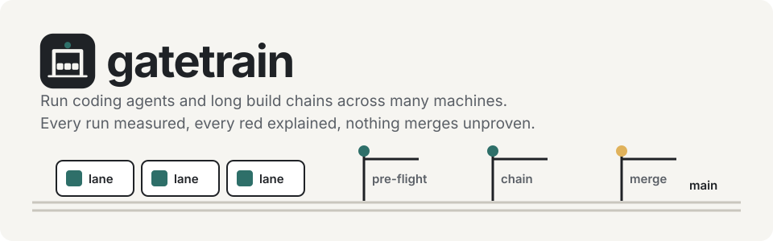
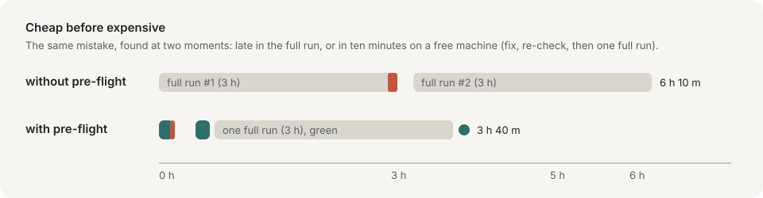
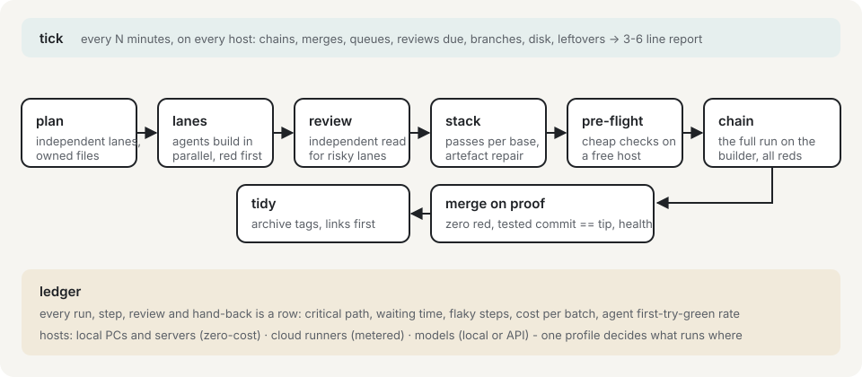
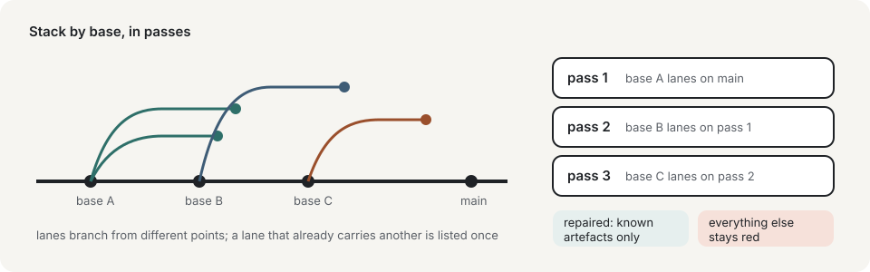
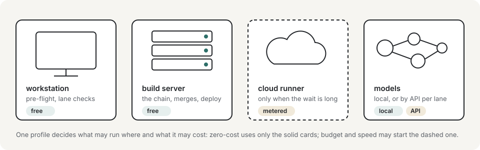

<p align="center">
  
</p>

<p align="center">
  <b>Run coding agents and long build chains across many machines.</b><br>
  Local PCs, home servers, cloud runners &mdash; every run measured, every red explained, nothing merges unproven.
</p>

<p align="center">
  <a href="#installation">Install</a> &middot;
  <a href="#how-it-works">How it works</a> &middot;
  <a href="#the-basic-workflow">Workflow</a> &middot;
  <a href="#profiles-from-zero-cost-to-cloud">Profiles</a> &middot;
  <a href="docs/lessons.md">Lessons</a> &middot;
  <a href="#roadmap">Roadmap</a>
</p>

<p align="center"><sub>Status: early. The method runs every day on a large monorepo; the scripts are being extracted and made generic. Skills, plugin and docs are usable today.</sub></p>

---

## Why gatetrain

Once several agents write code in parallel and one verification run takes hours, the hard part is no longer writing code. It is keeping the
line moving without lying to yourself.

| what goes wrong | what gatetrain does |
|---|---|
| A three-hour run dies on a mistake a ten-minute check would have caught. | **Pre-flight** every batch on a free machine first; the expensive run starts only when it is green. |
| Combining many branches quietly duplicates a line, drops a list entry, or re-applies old commits. | **Stack** by base, repair only known artefacts, and leave everything else red for a person. |
| An agent says "tests pass". | **Every claim carries its counts**, red first: a test that never failed has not proven anything. |
| Risky changes (money, permissions, data, network) slip through with the rest. | An **independent review** that gets the diff, not your conclusion, before the change is stacked. |
| Machines sit idle while work queues; the bill or the disk surprises you. | One **ledger** of every run and step: waiting time, idle hosts, flaky steps, cost per batch, agent quality. |
| Cleanup deletes real work. | **Tidy** that cannot: archive tags first, links unlinked first, exact names only, never the main checkout. |

<p align="center"></p>

## Installation

Installation differs by harness. The skills are plain Markdown, so any coding agent that reads files can use them.

### Claude Code (plugin)

```bash
/plugin marketplace add MassRelayAI/gatetrain
/plugin install gatetrain@gatetrain
```

### Any other agent (Codex, Cursor, Gemini CLI, OpenCode, ...)

Copy the skills where your agent reads instructions, and point its rules file at `skills/using-gatetrain/SKILL.md`:

```bash
git clone https://github.com/MassRelayAI/gatetrain
cp -r gatetrain/skills ./.agents/gatetrain-skills     # or your agent's skills or rules folder
```

### Your machines and the ledger

```bash
cp gatetrain/config/hosts.example.toml gatetrain/config/hosts.toml   # git-ignored: your machines, roles, disks, cost, profile
sqlite3 gatetrain.db < gatetrain/ledger/schema.sql                   # or Postgres: the numbers exist from day one
```

### Try it on your own chain log

Needs Python 3 only (standard library). Your chain prints a few marker lines, see [`docs/log-format.md`](docs/log-format.md).

```bash
bin/gatetrain ingest my-chain.log --db gatetrain.db        # parse it into the ledger (append-only)
bin/gatetrain report --db gatetrain.db --run my-chain      # totals, reds, slowest steps, busiest stretch
bin/gatetrain trace my-chain.log > trace.json              # open trace.json in https://ui.perfetto.dev
bin/gatetrain eta my-running.log --db gatetrain.db         # when will it end (needs earlier runs in the ledger)
bin/gatetrain next-tick --log my-running.log --db gatetrain.db   # when to look next
```

From the sample logs in `tests/fixtures/` (generated from real runs by `tools/synthesize_fixture.py`: real timings and shape, generic names): a 466-step run with one red, then a run in progress:

```text
$ gatetrain report --db gatetrain.db --run run-one-red
run run-one-red: red  commit 0a1b2c3d4  host builder-1
steps 466  finished 466  red 1  cached 0  unknown start 0
wall time 2h47m29s  busy time 16h55m15s  average parallelism 6.1
reds: e2e-001(rc=1)
10 slowest steps:
     39m33s  test-api
     32m47s  test-tools
     28m14s  cargo-test
...
$ gatetrain eta tests/fixtures/run-partial-red.log --db gatetrain.db
eta 2026-11-11T20:33:32.497407+07:00
band p25-p75: 2026-11-11T20:04:02.756155+07:00 .. 2026-11-11T21:14:40.820733+07:00
basis: 250 steps finished at 2.1/min, parallelism 5.3 (max seen 8), 215 steps remaining, last log line 2026-11-11T19:18:15+07:00
dominant remaining steps: db-gate-264 (~9m31s), db-gate-318 (~6m02s), db-gate-404 (~5m46s), db-gate-425 (~5m43s), db-gate-273 (~5m37s)
$ gatetrain next-tick --log tests/fixtures/run-partial-red.log --db gatetrain.db --now 2026-11-11T18:15:00+07:00
5 min - a red appeared in the last 5 minutes: look again at the minimum
```

Pre-run checks and a one-table view of several runs. Real output, from `doctor` on a Windows workstation with a small local config
(`reach = "local"`; the ps-based checks for watchers and locks are skipped there and say so; the duplicate port, the missing tool and the
unmounted removable disk are planted on purpose):

```text
$ gatetrain doctor --config local.toml
PASS  L18,L30  this-pc disk: F:/: 195 GB free >= 20
WARN  L18      this-pc disk: E:/external-ssd: removable disk is not mounted  -> fix: attach and mount E:/external-ssd; what it enables is dropped meanwhile
PASS  L18,L19  this-pc capacity: can run now: preflight
PASS  L31      this-pc containers: no exited container with prefix gate-
WARN  L24      this-pc watchers: skipped on windows: needs ps with elapsed time  -> fix: run this check on a host where it is supported
PASS  L29      this-pc toolchain: python: Python 3.12.10
FAIL  L29      this-pc toolchain: no-such-tool: does not resolve or prints no version  -> fix: install no-such-tool or fix the PATH or version file the chain uses
FAIL  L22      this-pc ports: duplicate port(s): 5500  -> fix: give every gate its own port
WARN  L32      this-pc lock: skipped on windows: needs stat and date  -> fix: run this check on a host where it is supported
PASS  L26      this-pc chain: no chain running
$ gatetrain status --log tests/fixtures/run-one-red.log --log tests/fixtures/run-partial-red.log --log tests/fixtures/run-stopped.log --now 2026-11-11T18:15:00+07:00
run              host       steps    reds  state    eta    band         next look (min)
run-one-red      builder-1  466/466  1     red      -      -            -
run-partial-red  builder-1  250/465  6     running  20:33  20:04-21:14  5
run-stopped      builder-1  31/465   1     stopped  -      -            -
next look: 5 min (run-partial-red: a red appeared in the last 5 minutes: look again at the minimum)
```

(The doctor output above is trimmed to one line per distinct check; the port lines for single ports are omitted.)
`gatetrain stop PATTERN [--follower PATTERN] [--yes]` is a dry run until `--yes`, and works on Linux only. The ssh runner and the Linux
checks are covered by tests with canned outputs, not yet by a run against a real host.

Before stacking, `gatetrain lanes` reads only git and tells you which lanes will collide, with each other, with a commit they both
carry, and with main itself. Real output from a throwaway repo (`auth` and `billing` branched from an unmerged side branch that edits
`server.rs`; `ui` from main and edits the same line; main has since moved on and edited the same import line as `ui`):

```text
$ gatetrain lanes --repo . --main main auth billing ui
lanes against main

1. bases and containment
   auth: merge-base 00e23bdd6, 2 own commits, base for stacking a18ea88c1
   billing: merge-base 00e23bdd6, 2 own commits, base for stacking a18ea88c1
   ui: merge-base 00e23bdd6, 1 own commits
   both carry 1 commits up to a18ea88c1 (auth and billing): stack with that tip as lane base
   pass 1: base 00e23bdd6 (on main): ui
   pass 1: stack the carried commits up to a18ea88c1 (base 00e23bdd6) on main, once, for auth and billing
   pass 2: base a18ea88c1 (carried tip, after pass 1): auth, billing

2. collision hotspots
   SAME-LINES  app.js  [ui x main] lines 2 -> certain conflict, merge by hand
   SAME-LINES  server.rs  [carried a18ea88c1 x ui] lines 2 -> certain conflict, merge by hand

3. doubled-line risk
   server.rs:2 [carried a18ea88c1 x ui] -> likely doubled line after stacking: keep one, check it appears once
   app.js:2 [ui x main] -> likely doubled line after stacking: keep one, check it appears once

4. resource clashes
   none

5. paired counts (heuristic)
   ui: EXPECTED 13 -> 12 in gate.mjs; count changed here but its check still says 13 in gate.test.mjs:1 -> update it

6. parallel plan
   group 1: ui
   group 2: auth, billing  (after the groups above; conflicts with them)
3 lanes: 2 independent groups; 2 certain conflicts; 0 shared hubs; 0 resource clashes
```

It is advice (exit 0 unless git fails); the same data with `--json`. Heuristics are listed in [`modules/plan.md`](modules/plan.md).

Run the tests with `python -m unittest discover -s tests -v`.

Works alongside single-branch development skill sets (brainstorming, plans, test-driven development, code review, such as
[Superpowers](https://github.com/obra/superpowers)): those make one lane good; gatetrain runs many lanes on many machines and proves the batch.

## How it works

<p align="center"></p>

Work is cut into **lanes** (one branch, one worktree, one owner, a list of owned files). Lanes whose files do not overlap run **in parallel**
on whatever machine has a free slot. Finished lanes are **stacked** into a **batch**, checked cheaply in a **pre-flight**, then proven by one
**chain** (the full verification run) on the builder. Only a chain that is green on exactly the tested commit **merges**. A cheap recurring
**tick** watches every machine, chain, lane and disk, acts only where a written rule covers it, and reports in a few lines. Everything is a row
in the **ledger**. Every failure that happened twice becomes a **lesson**: a rule plus a test that proves it.

<p align="center"></p>

### What a tick looks like (example)

```text
tick 14:53  batch-42 run 2: 255/440 steps, 0 red, merger armed
            preflight-1: lane gates idle; builder-1 SSD 176 GB free; 0 leftover containers
            lane auth-door READY (review: 2 should-fix, fixed; 8/8 gates as the app role)
            next: stack batch-43 when 42 merges (3 lanes, 1 base)
            waits on you: nothing
```

## The basic workflow

1. **using-gatetrain** - Activates when a session runs more than one lane, more than one machine, or a long verification run. Introduces the rest.
2. **plan-lanes** - Activates before work is split. Maps the code first, cuts lanes with owned files, finds hidden coupling, marks risky lanes, schedules the longest first across free machines.
3. **review-lane** - Activates when a lane is handed to a worker and when a risky lane is finished. A brief with red-first proof; an independent reviewer who gets the diff, not your conclusion.
4. **preflight-and-chain** - Activates when lanes are finished. Stacks by base, repairs known artefacts only, pre-flights on a free machine, runs the full chain on the builder, stops safely.
5. **tick** - Activates on a timer. Chains, merges, queues, reviews due, branches, disk; acts only on written rules; reports in a few lines.
6. **tidy** - Activates after a merge. Archive tags first, links unlinked first, exact names only, never the main checkout.

**Mandatory, not suggestions:** claims carry counts, tests fail before they pass, nothing merges unless the tested commit is the merged one.

## When something goes wrong

A batch went red three times, a run is slower than it should be, an agent claimed green and was not, the bill jumped. Ask your agent to
"diagnose this run": the **diagnose-run** skill collects the evidence lines, classifies the red (stacking artefact, flaky, real defect,
environment, process), names the fix, and turns anything seen twice into a lesson with a check that enforces it.

## What's inside

- **Orchestration** - `using-gatetrain`, `plan-lanes`, `preflight-and-chain`, `tick`
- **Quality** - `review-lane`, `diagnose-run`
- **Hygiene** - `tidy`
- **Reference** - the [method](docs/method.md), the [module pages](#modules), the [lessons](docs/lessons.md), the [ledger schema](ledger/schema.sql), [example hosts](config/hosts.example.toml)

## Modules

| module | what it does |
|---|---|
| [`plan`](modules/plan.md) | detect independent work (owned files, shared hubs, hidden coupling, resources); schedule it across hosts, critical path first |
| [`hosts`](modules/hosts.md) | the machines (local, server, cloud), their roles, limits and cost |
| [`tick`](modules/tick.md) | the recurring check; acts only on written rules |
| [`watch`](modules/watch.md) | watchers on remote logs that cannot go quietly wrong |
| [`chain`](modules/chain.md) | lock holder, per-step results, step cache, a stop that also cancels queued follow-ups |
| [`stack`](modules/stack.md) | combine lanes by base, repair known artefacts, pre-flight before the expensive run |
| [`review`](modules/review.md) | briefs, independent review for risky lanes, citation checks, persona juries |
| [`merge`](modules/merge.md) | merge only on proof, then deploy and wait for health |
| [`ledger`](modules/ledger.md) | runs, steps, hand-backs and host samples as rows |
| [`tidy`](modules/tidy.md) | cleanup that cannot destroy work |

## Profiles: from zero cost to cloud

<p align="center"></p>

| profile | where work runs | spend |
|---|---|---|
| `zero-cost` | local devices only: PCs, laptops, SSDs, home or office servers, WSL; local models where good enough | 0 |
| `budget` | local first; a cloud runner only when the measured wait passes your limit, under a monthly cap | capped |
| `speed` | the long chain on cloud runners; pre-flight and lane checks on local machines | metered |
| `mixed` | a build server for the chain, a workstation for pre-flight, cloud APIs for the agents | metered |

## How it compares

gatetrain is not a CI service or a workflow engine; it sits on top of whatever runs your steps.

| | merge queues (Zuul, bors, hosted queues) | CI analytics | workflow engines | **gatetrain** |
|---|---|---|---|---|
| test the merged result before merging | yes | &ndash; | &ndash; | yes, per batch |
| many machines incl. your own PCs, zero cost | partly | &ndash; | yes | **yes, by profile** |
| coding agents as workers, with briefs and reviews | &ndash; | &ndash; | &ndash; | **yes** |
| cheap pre-flight before the expensive run | &ndash; | &ndash; | &ndash; | **yes** |
| flaky steps, waiting time, cost per batch | &ndash; | yes | partly | **yes (ledger)** |
| safe cleanup of branches, worktrees, outputs | &ndash; | &ndash; | &ndash; | **yes** |

## Lessons it is built on

Forty-two so far, each with the rule and what enforces it ([`docs/lessons.md`](docs/lessons.md)). Three of them:

- A stop that kills the run but not the merger scheduled five minutes later lets that merger attach to the next run. **A stop cancels queued follow-ups too.**
- Database tests that run as a superuser pass while the real application role is denied. **Every database lane runs one step as the application role.**
- Three long runs stopped on reds a ten-minute check would have found. **Pre-flight first.**

## Philosophy

- **Proof over claims.** A number and the command that produced it, or it did not happen.
- **Cheap before expensive.** Ten minutes on a free machine before three hours on the builder.
- **Repair only what you understand.** Known artefacts are fixed automatically; everything else stays red for a person.
- **Independent eyes on risk.** Whoever wrote it does not review it.
- **Nothing is lost in cleanup.** Archive, unlink, then remove.
- **Zero cost is a first-class mode.** Your own machines are a fleet.

## Roadmap

- [x] Method, lessons, module pages, host profiles, ledger schema
- [x] Agent skills: using-gatetrain, plan-lanes, review-lane, preflight-and-chain, tick, diagnose-run, tidy
- [x] Claude Code plugin manifest and marketplace
- [x] `gatetrain doctor` (pre-run checks per host, disks as resources) and `gatetrain stop` (chain plus queued followers)
- [ ] `gatetrain tick` and `gatetrain watch` (generic, host-aware); `status` and multi-log `next-tick` are built
- [ ] `gatetrain chain` (holder, step runner, stop)
- [x] Ledger writer: `gatetrain ingest` (chain logs into runs and steps), `report`, `trace` (Perfetto timeline)
- [x] `gatetrain eta` (prediction from the ledger) and `gatetrain next-tick` (adaptive cadence)
- [ ] `gatetrain stack` with base detection, artefact repair and pre-flight on a free host
- [x] `gatetrain lanes`: pre-stack collision radar (bases, containment, hotspots, doubled lines, port clashes, paired counts, parallel groups)
- [ ] `gatetrain plan`: declared owned files per lane, hidden coupling via a code graph, scheduling across hosts, critical path
- [x] Ledger views: critical path approximation (`report`), flaky steps (`flaky`)
- [ ] Ledger views: cost per batch, agent scorecard
- [ ] Cloud adapters for the `budget` and `speed` profiles

## Contributing

Issues and lessons are welcome: a failure you hit twice, the rule you wrote for it, and the test that proves it.

## Brand


The gatetrain mark: a train of lanes passing under a gate with a green signal. SVG in [`docs/assets/logo.svg`](docs/assets/logo.svg), light and dark.
<br clear="left">

## Licence

[Apache License 2.0](LICENSE) - use it, change it, ship it, commercially too; keep the notice, and the patent grant protects everyone who uses it.
