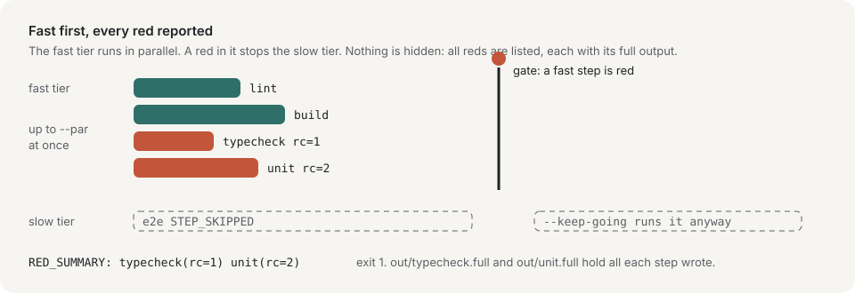

# `gatetrain chain`: the step runner

`gatetrain chain` runs a **steps file**: a list of checks, each with its own exit code, in two tiers. The fast tier runs first, in
parallel. If a fast step is red the slow tier does not start. Every red is reported, never only the first, and each step's full output is
kept in its own file. A green run on a clean git tree writes a **stamp** that says which commit was proven by which steps.

<p align="center"></p>

It is built for the cheap run before the expensive one (the pre-flight of [the method](method.md)). A proof run (`CHAIN_MODE full`) is
not what `chain` produces today: it always prints `CHAIN_MODE preflight` and stamps `mode: preflight`.

## A minimal example

A git repository with this `steps.toml` (the `.gitignore` lists `out/` and `cache/`):

```toml
cwd = "."

[[step]]
name = "lint"
tier = "fast"
run = "echo lint ok"

[[step]]
name = "unit"
tier = "fast"
run = "echo 3 passed"
inputs = ["web/**"]

[[step]]
name = "e2e"
tier = "slow"
needs = ["unit"]
timeout_s = 600
run = "echo e2e ok"
```

Real output, first run (the host name is replaced by `builder-1`; the rest is as printed):

```text
$ gatetrain chain --steps steps.toml --out out --cache cache
branch master at 9e7eba84b7befc39b6bb0492a447707361a30752 on builder-1
CHAIN_MODE preflight
CHAIN_PARALLEL 4
STEP_START lint 2026-11-17T13:06:50.636601+00:00
STEP_START unit 2026-11-17T13:06:50.736785+00:00
STEP_TIME lint 0.1s
STEP_EXIT lint 0
STEP_TIME unit 0.1s
STEP_EXIT unit 0
STEP_START e2e 2026-11-17T13:06:50.792727+00:00
STEP_TIME e2e 0.1s
STEP_EXIT e2e 0
RED_SUMMARY: none
GATES_DONE
chain: green, stamp out\stamp-9e7eba84b7befc39b6bb0492a447707361a30752.json
```

Second run, nothing changed under `web/`: `unit` is a cache hit and runs nothing.

```text
$ gatetrain chain --steps steps.toml --out out --cache cache
...
STEP_START unit 2026-11-17T13:06:51.129989+00:00
STEP_CACHED unit
STEP_TIME unit 0.0s
STEP_EXIT unit 0
...
chain: green, stamp out\stamp-9e7eba84b7befc39b6bb0492a447707361a30752.json
```

The stamp then lists `"cached": ["unit"]`.

A red run. Here `typecheck` and `unit` fail, so `e2e` (slow) is skipped, and the exit code is 1:

```text
$ gatetrain chain --steps bad.toml --out out2
branch master at 9e7eba84b7befc39b6bb0492a447707361a30752 on builder-1
CHAIN_MODE preflight
CHAIN_PARALLEL 4
STEP_START lint 2026-11-17T13:06:58.966214+00:00
STEP_START typecheck 2026-11-17T13:06:58.966286+00:00
STEP_START unit 2026-11-17T13:06:58.966318+00:00
STEP_TIME lint 0.1s
STEP_EXIT lint 0
STEP_TIME unit 0.1s
STEP_EXIT unit 2
RED_NOW unit rc=2 at 2026-11-17T13:06:59.097623+00:00 (full output: unit.full)
STEP_TIME typecheck 0.1s
STEP_EXIT typecheck 1
RED_NOW typecheck rc=1 at 2026-11-17T13:06:59.100061+00:00 (full output: typecheck.full)
STEP_SKIPPED e2e a fast step is red; --keep-going runs slow anyway
RED_SUMMARY: typecheck(rc=1) unit(rc=2)
GATES_DONE
$ cat out2/typecheck.full
error: expected 1 argument
```

Stdout carries [log-format](log-format.md) lines and a last `chain:` summary line the parser ignores, so the output is a chain log that `parse`, `report` and `diagnose` read as it is
(redirect it to a file). A step's own output goes to `<out>/<step>.full`, streamed while it runs.

## The steps file

TOML. Unknown keys are refused (exit 2).

| key | where | meaning |
|---|---|---|
| `cwd` | top level, optional | the working directory of every step. A relative path is relative to the steps file, so the file means the same from wherever it is run. Without it, the caller's directory. |
| `[[step]]` | at least one | one check. |
| `name` | step, required | letters, digits, `.`, `_`, `-` only. Unique. It names the `.full` file. |
| `tier` | step, required | `"fast"` or `"slow"`. |
| `run` | step | a shell string. Give exactly one of `run` and `argv`. |
| `argv` | step | the program and its arguments, run without a shell. Not empty. |
| `needs` | step, optional | names of steps that must be green first. A step whose need is red or skipped is skipped. Unknown names and cycles are refused. A fast step may not need a slow one. |
| `timeout_s` | step, optional | a positive number of seconds. On expiry the whole process tree is killed (Linux and Windows) and the step is red with exit 124; the output so far is kept. |
| `inputs` | step, optional | git pathspecs, relative to `cwd`, that the step reads. With `--cache`, a step whose inputs are unchanged since it last passed is not run again. No `inputs`: never cached. |
| `cache_salt` | step, optional | a string mixed into the cache key. Change it to invalidate the step's entries (a tool version, an environment the inputs do not show). |

On Windows a `run` string goes to the Windows shell, so use `argv` (for example `["sh", "-c", "..."]`) for anything with shell syntax.

## Tiers, order and skips

- The fast tier runs first, up to `--par` steps at once (default 4). The slow tier then runs the same way.
- A tier that has started runs to its end, so every red of the tier is reported. `RED_NOW` is printed the moment a step fails.
- A red fast step skips the slow tier unless `--keep-going`. A skipped step prints `STEP_SKIPPED <step> <reason>`; it counts in no step total.
- `--only a,b` runs just those steps, `--skip c` leaves steps out. A name that is no step is refused. A step that needs a step outside the
  selection does not wait for it.

## The step cache (pre-flight only)

`--cache <dir>` skips a step whose inputs have not changed since it last passed.

- The key is a sha-256 over the step's command, its directory relative to the repository top, its `cache_salt` and `git ls-files -s -- <inputs>`.
  Relative to the top means two worktrees of one commit share an entry.
- **Dirty or untracked inputs** mean the step runs and writes no entry; its `.full` says why. The same holds when no tracked file matches `inputs`.
- **Only a green run writes an entry.** A red is never cached.
- A hit prints `STEP_START`, `STEP_CACHED <step>`, `STEP_TIME <step> 0.0s`, `STEP_EXIT <step> 0`, runs nothing, and counts as green for `needs`.
- `--no-cache-for a,b` forces those steps to run.
- The cache folder is per host and your choice; nothing is shared implicitly. **A proof run must not pass `--cache`**: `batch` refuses cached steps as proof.

## The stamp

A green run on a git tree that is clean before and after writes `<out>/stamp-<sha>.json`: the commit, host, time, `mode` (`preflight`),
`par`, total seconds, the `digest` (sha-256 of the steps file), each step with tier, exit code and seconds, and `cached`, the list of steps
that came from the cache. The `<out>` folder itself is not counted as part of the tree. No stamp is written for a red run, a dirty tree or a
directory that is not a git repository; the last line says why. The stamp is what the batch engine's lane-stamp rule reads
(`[lanes] require_stamp`, see [ADR 002](design/adr-002-lane-stamp-and-cause-gated-rerun.md)).

## Exit codes

| code | meaning |
|---|---|
| 0 | every selected step green (or cached) |
| 1 | at least one step red; `RED_SUMMARY` lists them |
| 2 | configuration error: bad steps file, unknown `--only`, `--skip` or `--no-cache-for` name |

Inside `.full` and `STEP_EXIT`, a timeout is 124 and a step that could not be started is 127.

## Options

`gatetrain chain --help` is the source of truth: `--steps` and `--out` (required), `--par`, `--keep-going`, `--only`, `--skip`, `--cache`,
`--no-cache-for`.

## Read the result

```bash
gatetrain chain --steps steps.toml --out out > run.log       # the exit code is the verdict
gatetrain diagnose run.log                                    # causes, then every red step
gatetrain ingest run.log --db gatetrain.db                    # into the ledger
```

`diagnose` reads a step's output only between a `=== <step>` banner and the next marker in the log. A `chain` log carries no banner, because
the output is in the `.full` files, so a red from `chain` reaches the classifier without evidence lines. Feeding the `.full` files to
`diagnose` is planned (engine-v2, slice E1).
